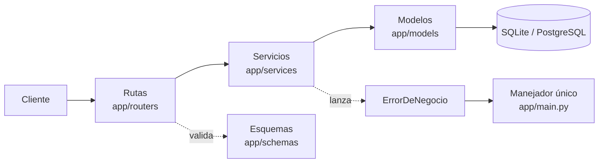

<div align="center">

# ReservaYa · API

**Backend del sistema de reservas de restaurantes**

[](https://github.com/leonardeco/reservayabackend/actions/workflows/ci.yml)


</div>

ReservaYa permite a los comensales consultar restaurantes, ver su disponibilidad y reservar una mesa, y a cada restaurante administrar sus reservas y su información desde un panel. Este repositorio contiene la **API REST** que respalda ambas experiencias.

Proyecto desarrollado para la asignatura **Mantenimiento de Software** (Ingeniería de Software, Corporación Universitaria Iberoamericana).

---

## Contenido

- [Características](#características)
- [Historias de usuario](#historias-de-usuario)
- [Tecnologías](#tecnologías)
- [Primeros pasos](#primeros-pasos)
- [Referencia de la API](#referencia-de-la-api)
- [Arquitectura](#arquitectura)
- [Pruebas y calidad](#pruebas-y-calidad)
- [Despliegue](#despliegue)
- [Flujo de trabajo con Git](#flujo-de-trabajo-con-git)
- [Estructura del repositorio](#estructura-del-repositorio)
- [Equipo](#equipo)

## Características

- **Catálogo de restaurantes** con búsqueda por texto (insensible a tildes y mayúsculas) y filtros por zona, categoría, precio y calificación.
- **Disponibilidad por franjas** según los turnos de atención, los bloqueos de fecha y las reservas ya hechas.
- **Reservas con asignación automática de mesa**: se elige la mesa más pequeña donde quepa el grupo y se entrega un código de confirmación (`RY-AAAAMMDD-NNNN`).
- **Panel del administrador** protegido con sesión: reservas del día, confirmar o cancelar, estadísticas y edición del perfil del restaurante.
- **Seguridad sin dependencias extra**: contraseñas con PBKDF2-SHA256 y sal aleatoria, y tokens firmados con HMAC-SHA256 que vencen a las 8 horas.
- **Errores de negocio uniformes**: cada error conoce su código HTTP y responde `{"detail": "<codigo>"}`.
- **Control de concurrencia**: al reservar se bloquean las mesas del restaurante (`FOR UPDATE` en PostgreSQL), de modo que dos reservas simultáneas no se quedan con la misma mesa.
- **Migraciones versionadas** con Alembic y **contrato OpenAPI** publicado en `docs/api/openapi.json`.

## Historias de usuario

| ID | Usuario | Necesidad principal |
|---|---|---|
| HU01 | Comensal | Consultar restaurantes y su disponibilidad. |
| HU02 | Comensal | Realizar una reserva y recibir el código de confirmación. |
| HU03 | Administrador | Iniciar sesión para acceder a funciones de gestión del restaurante. |
| HU04 | Administrador | Consultar información sobre ocupación y reservas. |
| HU05 | Administrador | Consultar y cambiar la información general del restaurante. |

## Tecnologías

| Área | Herramienta |
|---|---|
| Lenguaje | Python 3.12 |
| Framework web | FastAPI 0.162 con Uvicorn |
| Acceso a datos | SQLAlchemy 2.1 y Alembic (migraciones) |
| Base de datos | SQLite en desarrollo · PostgreSQL 16 en CI y producción |
| Configuración | Pydantic Settings (variables de entorno) |
| Pruebas | pytest y pytest-cov |
| Calidad | Ruff (lint y formato) |
| Integración continua | GitHub Actions |
| Despliegue | Render (Blueprint) |

## Primeros pasos

### Requisitos

- Python 3.12
- Git
- *(Opcional)* PostgreSQL 16, para correr las pruebas igual que en la integración continua

### Instalación

```bash
git clone https://github.com/leonardeco/reservayabackend.git
cd reservayabackend/backend

python -m venv .venv
# Git Bash:    source .venv/Scripts/activate
# PowerShell:  .venv\Scripts\Activate.ps1
# Linux/macOS: source .venv/bin/activate

pip install -r requirements-dev.txt
cp .env.example .env
alembic upgrade head
python -m seeds.seed      # restaurantes, mesas, horarios, administrador y reservas de ejemplo
uvicorn app.main:app --reload --port 8000
```

Con el servidor en marcha:

| Recurso | Dirección |
|---|---|
| Estado del servicio | http://localhost:8000/api/v1/health |
| Documentación interactiva (Swagger) | http://localhost:8000/api/v1/docs |
| Contrato OpenAPI | http://localhost:8000/api/v1/openapi.json |

**Usuario de prueba del panel:** `La Terraza` / `terraza123`

### Variables de entorno

Se definen en `backend/.env` (hay una plantilla en `backend/.env.example`).

| Variable | Descripción | Por defecto |
|---|---|---|
| `ENV` | Entorno: `dev`, `test` o `prod` | `dev` |
| `DATABASE_URL` | Conexión a la base de datos. Acepta `postgres://` y `postgresql://` | `sqlite:///./reservaya.db` |
| `SECRET_KEY` | Clave que firma los tokens del panel. **Obligatoria en producción** (mínimo 32 caracteres) | clave de desarrollo |
| `TOKEN_HORAS` | Duración de la sesión del administrador, en horas | `8` |
| `CORS_ORIGINS` | Orígenes permitidos por CORS, separados por coma | vacío (solo mismo origen) |

## Referencia de la API

Todas las rutas empiezan por `/api/v1`. Las rutas `/admin/*` exigen la cabecera `Authorization: Bearer <token>`.

| Historia | Método y ruta | Descripción |
|---|---|---|
| HU01 | `GET /restaurantes` | Lista con filtros `q`, `zona`, `categoria`, `precio`, `rating_min`. Con `fecha` y `personas` devuelve solo los restaurantes con alguna franja libre |
| HU01 | `GET /restaurantes/{slug}` | Detalle de un restaurante |
| HU01 | `GET /restaurantes/{slug}/disponibilidad?fecha=&personas=` | Franjas del día (`libre` / `agotada`) |
| HU02 | `POST /restaurantes/{slug}/reservas` | Crea la reserva, asigna mesa y devuelve el código de confirmación |
| HU03 | `POST /auth/login` | Usuario y contraseña → token de sesión |
| HU04 | `GET /admin/reservas?fecha=` | Reservas del día y resumen: reservas, mesas libres, ocupación y pendientes |
| HU04 | `PATCH /admin/reservas/{id}` | Cambia el estado a `Confirmada` o `Cancelada` |
| HU04 | `GET /admin/estadisticas` | Reservas del mes, ocupación de la semana y reservas por hora |
| HU05 | `GET /admin/restaurante` | Perfil del restaurante del administrador |
| HU05 | `PUT /admin/restaurante` | Guarda el perfil |

### Ejemplo

```bash
# 1. Disponibilidad de La Terraza para 2 personas
curl "http://localhost:8000/api/v1/restaurantes/la-terraza/disponibilidad?fecha=2026-12-04&personas=2"

# 2. Reservar
curl -X POST http://localhost:8000/api/v1/restaurantes/la-terraza/reservas \
  -H "Content-Type: application/json" \
  -d '{"fecha":"2026-12-04","hora":"19:30","personas":2,"nombre":"Juan García",
       "telefono":"+57 300 000 0001","correo":"juan@correo.com","notas":"Cumpleaños"}'

# 3. Iniciar sesión como administrador y consultar las reservas del día
TOKEN=$(curl -s -X POST http://localhost:8000/api/v1/auth/login \
  -H "Content-Type: application/json" \
  -d '{"usuario":"La Terraza","password":"terraza123"}' | python -c "import sys,json; print(json.load(sys.stdin)['token'])")

curl -H "Authorization: Bearer $TOKEN" http://localhost:8000/api/v1/admin/reservas
```

### Errores

| HTTP | `detail` | Cuándo |
|---|---|---|
| 401 | `credenciales_invalidas` | Usuario o contraseña incorrectos |
| 401 | `no_autenticado` | Falta el token, está vencido o fue alterado |
| 404 | `restaurante_no_encontrado` | El restaurante no existe |
| 404 | `reserva_no_encontrada` | La reserva no existe o no es de tu restaurante |
| 409 | `fuera_de_horario` | El restaurante no atiende a esa hora, la hora ya pasó o el día está bloqueado |
| 409 | `sin_mesa_disponible` | No queda mesa para ese número de personas a esa hora |
| 409 | `cambio_de_estado_invalido` | Por ejemplo, confirmar una reserva ya cancelada |
| 422 | `fecha_fuera_de_rango` | Fecha pasada o más allá de la antelación permitida |

### Reglas de negocio

- Una reserva ocupa la mesa **90 minutos** desde la hora elegida; dos reservas chocan si sus intervalos se solapan.
- Se acepta cualquier hora dentro del horario del día (por ejemplo, 19:30 aunque las franjas sean cada 90 minutos).
- Se asigna **la mesa más pequeña** donde quepa el grupo, para dejar libres las grandes.
- Una reserva **cancelada** libera su mesa y no se puede volver a confirmar.
- Cada administrador solo ve y modifica **su propio restaurante**.

## Arquitectura

El código está organizado por capas y orientado a objetos: las rutas reciben la petición y delegan en servicios, que concentran las reglas de negocio y son los únicos que hablan con los modelos.



| Capa | Carpeta | Clases principales |
|---|---|---|
| Modelos (tablas) | `app/models/` | `Restaurante`, `Mesa`, `HorarioTurno`, `BloqueoFecha`, `Reserva`, `Administrador` |
| Esquemas (entrada y salida) | `app/schemas/` | `RestauranteRead`, `DisponibilidadRead`, `ReservaCrear`, `ReservaCreada`, `LoginEntrada`, `Perfil`, `Estadisticas` |
| Servicios (reglas) | `app/services/` | `ReservaService`, `AuthService`, `PanelService`, `calcular_disponibilidad` |
| Errores | `app/services/errores.py` | `ErrorDeNegocio` y sus subclases, cada una con su código HTTP |
| Seguridad | `app/core/seguridad.py` | `HashContrasena`, `FirmadorTokens` |
| Rutas | `app/routers/` | Una por recurso: restaurantes, reservas, auth, admin y health |

## Pruebas y calidad

```bash
cd backend
pytest              # 87 pruebas con reporte de cobertura (mínimo exigido: 70 %)
ruff check .        # lint
ruff format .       # formato
```

- Por defecto las pruebas usan SQLite en un directorio temporal.
- Si se define `TEST_DATABASE_URL` con una URL de PostgreSQL (la base debe terminar en `_test`), corren contra PostgreSQL, incluidas las pruebas de concurrencia.
- El contrato `docs/api/openapi.json` se regenera con `python -m scripts.export_openapi`; una prueba falla si quedó desactualizado.
- La cobertura actual ronda el **99 %**.

### Integración continua

Cada Pull Request y cada `push` a `main` ejecutan en GitHub Actions: instalación, lint y formato con Ruff, migraciones, pruebas con cobertura sobre **PostgreSQL 16** y una segunda pasada sobre SQLite.

## Despliegue

El archivo [`render.yaml`](render.yaml) define el despliegue en [Render](https://render.com) como *Blueprint*:

1. En Render: **New → Blueprint** y elegir este repositorio.
2. Render crea el servicio `reservaya-api` y la base `reservaya-db`, genera `SECRET_KEY` y conecta `DATABASE_URL`.
3. Al arrancar se ejecutan `alembic upgrade head` y `python -m seeds.seed`; la carga de datos es idempotente y no pisa lo que el administrador ya haya cambiado.
4. Verificar con `GET /api/v1/health`.

> El plan gratuito de Render se duerme tras un rato sin uso, por lo que la primera petición puede tardar unos segundos.

## Flujo de trabajo con Git

- `main` siempre está estable: solo recibe cambios por **Pull Request** con la integración continua en verde.
- **Una rama por historia de usuario**, con el formato `feat/hu0X-descripcion`.
- Cada historia se divide en commits pequeños y con mensajes que siguen *Conventional Commits*:

| Prefijo | Uso |
|---|---|
| `feat(huXX):` | Funcionalidad nueva |
| `test(huXX):` | Pruebas |
| `docs:` | Documentación |
| `chore:` | Mantenimiento y configuración |

## Estructura del repositorio

```text
.
├── .github/workflows/ci.yml     Integración continua
├── backend/
│   ├── app/
│   │   ├── core/                Configuración, seguridad y reloj inyectable
│   │   ├── db/                  Sesión y base declarativa de SQLAlchemy
│   │   ├── models/              Tablas
│   │   ├── routers/             Endpoints
│   │   ├── schemas/             Validación de entrada y salida
│   │   ├── services/            Reglas de negocio
│   │   ├── deps.py              Dependencias de FastAPI (sesión, autenticación)
│   │   └── main.py              Aplicación y manejo de errores
│   ├── alembic/                 Migraciones de la base de datos
│   ├── scripts/                 Exportación del contrato OpenAPI
│   ├── seeds/                   Carga inicial de datos de ejemplo
│   └── tests/                   Pruebas automáticas
├── docs/api/openapi.json        Contrato de la API
└── render.yaml                  Despliegue en Render
```

## Equipo

| Integrante | Historias |
|---|---|
| José Leonardo Guzmán Tobón ([@leonardeco](https://github.com/leonardeco)) | Estructura base, HU01, HU02 |
| Saleth Tatiana Ibarra Martínez ([@Stim26](https://github.com/Stim26)) | HU03, HU05 |
| Kevin Smith Correal Chocontá ([@KevinnC18](https://github.com/KevinnC18)) | HU04 |

**Docente:** Ing. Rogelio Vásquez · **Institución:** Corporación Universitaria Iberoamericana · Colombia
